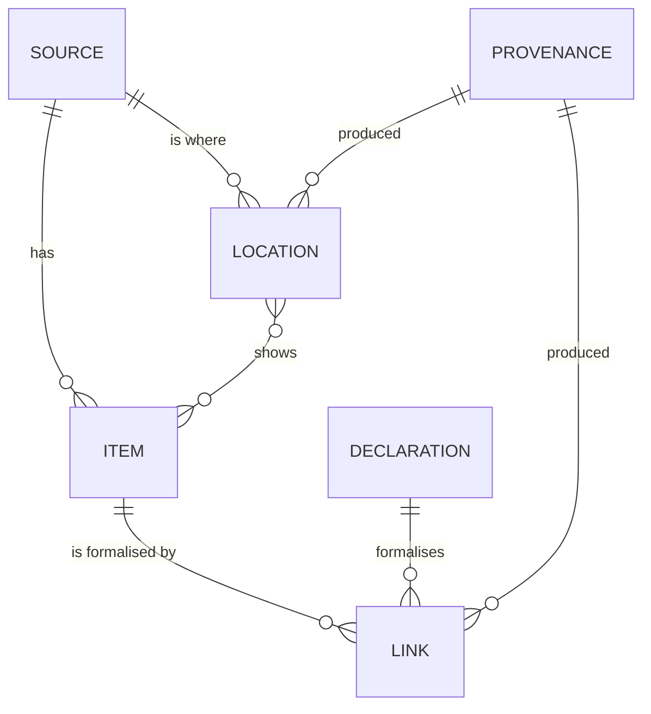

# formal-companion-annotations

**One JSON file per Lean companion that says which Lean declarations formalise
which items of which sources, and where those items sit in the sources.**

A *Lean companion* is a Lean 4 repository that formalises a book, a set of
lecture notes or a paper. Today every companion invents its own way to say
"this declaration formalises Definition 1.2": a docstring tag, a table, a
dependency graph, a blueprint macro. Nothing built for one companion works for
the next. This format is the one file a companion can publish so that a PDF
overlay, a rendered site, an audit or a dataset builder can join the book and
the Lean without reading either repository's own conventions. It holds no
book text: only identifiers, page geometry and short anchoring quotes.

This repository is the format and nothing else:

- the specification ([`docs/annotations.md`](docs/annotations.md)) and the
  id algorithm ([`docs/id-algorithm.md`](docs/id-algorithm.md));
- the JSON Schema ([`schema/annotations-v1.0.schema.json`](schema/annotations-v1.0.schema.json));
- a checker for the invariants no JSON Schema can state, as the Python
  package `formal_companion_annotations` (standard library only, Python 3.11+);
- synthetic examples and a language-neutral conformance suite
  ([`conformance/`](conformance/)).

## Status

**Release candidate (`1.0.0rc2`).** The format's version is `1.0`. The
package and the format follow the compatibility rules in
[`docs/annotations.md`](docs/annotations.md) section 12, but until `1.0.0`
is released a release candidate may still change the format. `1.0.0` will
be released when all of the following hold:

1. at least one reader other than the checker consumes documents (an overlay,
   a site, a dataset builder);
2. documents have been produced for at least three companions, one of which
   uses none of the conventions the format was first designed against;
3. each of those companions validates its exported document in its own CI at
   every commit.

## A complete document

The smallest useful document: one source, one item, one declaration, one
link, one provenance record. It is [`examples/annotations/minimal.json`](examples/annotations/minimal.json)
and it validates as it stands.

```json
{
  "companion": {
    "commit": "ed00b5dc6b11040ed2f9baf475edc9b48e1c7f4a",
    "generated_at": "2026-09-26T12:00:00Z",
    "generator": "hand",
    "name": "notes-companion",
    "repo": "git.example.org/example/notes-companion"
  },
  "declarations": [
    {
      "anonymous": false,
      "file": "Notes/Basic.lean",
      "id": "Notes.Box.volume_nonneg",
      "id_source": "name",
      "kind": "theorem",
      "line": 41,
      "module": "Notes.Basic",
      "name": "Notes.Box.volume_nonneg",
      "private": false
    }
  ],
  "items": [
    {
      "form": "numbered",
      "id": "lemma-1.2",
      "id_source": "label",
      "kind": "Lemma",
      "number": "1.2",
      "pages": {
        "basis": "printed",
        "first": 5
      },
      "source": "notes-pdf"
    }
  ],
  "links": [
    {
      "declaration": "Notes.Box.volume_nonneg",
      "id": "lemma-1.2/key/Notes.Box.volume_nonneg",
      "item": "lemma-1.2",
      "provenance": "prov-curation",
      "role": "key"
    }
  ],
  "provenance": [
    {
      "actor": "human",
      "confirmed_by_human": true,
      "id": "prov-curation",
      "method": "curation"
    }
  ],
  "schema": "formal-companion/annotations",
  "schema_version": "1.0",
  "sources": [
    {
      "id": "notes-pdf",
      "kind": "pdf",
      "sha256": "e45a0b99dd11778aac792ecd226d150a9d28b82c9e2897510f441235956a3b07",
      "title": "Elementary Sets: Lecture Notes (synthetic)"
    }
  ]
}
```

Reading it: the **source** is a PDF pinned by its sha256. The **item** is
"Lemma 1.2" of that source, on printed page 5. The **declaration** is a
named Lean theorem at a pinned commit of the companion. The **link** says the
declaration is the `key` formalisation of the item (it states the whole item),
and names the **provenance** record that says who claims so and how.

## Concepts



- **sources**: the editions annotated (a PDF, a web page, a rendered site, a
  `.tex` or `.lean` file, any other medium), each pinned by a hash, an
  immutable revision or, for a PDF whose bytes the producer does not hold,
  a DOI, ISBN or arXiv identifier.
- **items**: numbered items (`Definition 1.1`) and unnumbered passages, with
  their coverage class and, optionally, cross-references to external
  databases (Stacks Project, Kerodon, Wikidata, LMFDB).
- **declarations**: the Lean declarations anything mentions. Named ones use
  their name as id; anonymous `example`s and instances get a mechanical id
  from a hash of their statement.
- **links**: item to declaration, with a role (`key`, `attributed`, `support`,
  `example`, `helper`) and a relation (`exact`, `special_case`, `part`, ...).
- **locations**: where an item sits in a source, as a W3C Web Annotation
  target: a PDF region, a page, a quote, an HTML element, a page of a site,
  a line range in a file.
- **provenance**: who produced the links and locations, and how.

Four optional **profiles** add more, each versioned on its own: `graph` (a
companion's own dependency graph: clusters, memberships, artifacts), `site`
(where declarations are rendered on a companion site, and statement
snippets), `audit` (adjudicated faithfulness verdicts), `history` (id
events: retired, restated, renamed). A reader that does not implement a
profile ignores it.

## Install

Releases and release candidates are published to PyPI as
`formal-companion-annotations`. A release candidate is a pre-release, so
`pip` needs `--pre` until `1.0.0` is out:

```sh
python3 -m pip install --pre formal-companion-annotations
```

From a checkout, until a release candidate is on PyPI:

```sh
python3 -m pip install .
```

Nothing else is installed: the checker is standard library only.

## Validate

```sh
formal-companion-annotations-validate my-companion.annotations.json
```

```sh
formal-companion-annotations-validate my-companion.annotations.json --canonical --lint external-urls
```

```sh
formal-companion-annotations-validate my-companion.annotations.json --print-canonical > fixed.json
```

`python3 -m formal_companion_annotations` runs the same checker. It reads the
document's `schema_version` and evaluates the JSON Schema of that exact
minor. It then checks the invariants of the specification (section 9):
unique and sorted ids, references that resolve, the coverage and link rules,
the id rules, the selector grammars, the profile gating. The flags:

- `--canonical` also requires the file's bytes to be the canonical form;
- `--print-canonical` sorts one document, validates the result and writes
  that form to standard output, so a producer never has to hand-sort;
  problems and warnings go to standard error;
- `--lint NAME` adds an opt-in check that is not part of validity
  (`external-urls`: no URL outside the fields meant to hold one);
- `--format json` prints one JSON object per document instead of text lines;
- `--version` prints the package version.

Output, one line each:

- `<file>: <path>: <message> [<code>]` for each problem;
- `<file>: warning: <path>: <message> [<code>]` for each warning;
- `<file>: ok (<counts>)` for a valid document;
- `<file>: cannot read: <message>` for a file that is not I-JSON or cannot
  be opened (on standard error).

For example:

```
examples/annotations/minimal.json: ok (1 sources, 1 provenance, 1 items, 1 declarations, 1 links)
examples/annotations/invalid-dangling-reference.json: $.links[2].declaration: 'Notes.Box.volume_pos' is not an id in declarations[] [I3]
```

Exit status: **0** every document is valid; **1** at least one is invalid;
**2** at least one could not be read (not JSON, a duplicate key, a number
too large, a lone surrogate), a usage error, a broken install or an internal
error. The codes (`SCHEMA`, `IJSON`, `I1` to `I14` with `I10` retired,
`L1`, `W-...`) are stable across releases; the wording of a message is not.

### From Python

```python
from formal_companion_annotations import validate

data = open("doc.json", "rb").read()
doc = validate.loads(data)                       # strict I-JSON; str or bytes
report = validate.check(doc, text=data, canonical=True, lints=("external-urls",))
report.ok                                        # True when there are no problems
for problem in report.problems:                  # Problem(code, path, message)
    print(problem.code, problem)                 # str(problem) is "<path>: <message>"
canonical = validate.canonical_dumps(validate.canonicalize(doc))
```

`report.warnings` has the same shape. `validate.PROFILES` says what each
profile owns, `validate.LINTS` names the lints, and `validate.validate()`
returns the problems as strings. [`ids`](src/formal_companion_annotations/ids.py)
is the reference implementation of the id rules (statement hashes for
anonymous declarations, passage ids), and
[`vocab`](src/formal_companion_annotations/vocab.py) holds every enum. The
stable Python API is each module's `__all__` (`docs/annotations.md` section
11.6); the package ships `py.typed`. Any JSON Schema 2020-12 implementation
can check the schema alone; only this checker also checks the invariants.

## Repository layout

```
README.md, CHANGELOG.md, CONTRIBUTING.md, LICENSE
docs/annotations.md                      the specification
docs/id-algorithm.md                     the id rules, as an algorithm
docs/vocabulary.md                       every enum value and its meaning
docs/mapping-notes.md                    how common attribution conventions map in (informative)
docs/history.md                          where the code came from (informative)
schema/annotations-v1.0.schema.json      the JSON Schema (the package ships the same bytes)
src/formal_companion_annotations/        the package: validate, schemacheck, ids, vocab, schema/
examples/annotations/                    synthetic documents; invalid-*.json fail on purpose
conformance/                             language-neutral test vectors, and the Node runner in js/
tests/                                   stdlib unittest, run with pytest or unittest
pyproject.toml, MANIFEST.in              packaging: the wheel is the package; the sdist runs its tests
.github/workflows/                       tests.yml (CI) and release.yml (PyPI, trusted publishing)
.github/ISSUE_TEMPLATE/                  format change proposal, checker bug
```

The examples are synthetic: every non-Lean source title says so, and nothing
here quotes a real book.

## Tests

```sh
python3 -m pytest
```

```sh
python3 -m unittest discover -s tests
```

Neither command needs the package installed. When `jsonschema` is importable,
the suite also checks that it agrees with the package's own evaluator on every
example and on random mutations of them. CI runs Python 3.11 to 3.14, the
installed wheel, the sdist, and a Node job that validates the conformance
documents against the schema with `ajv` and checks the canonical-form vectors
against a JavaScript reference implementation.

## Reporting a problem

A checker that accepts a document the specification forbids, refuses one it
allows, crashes, or disagrees with the schema or the conformance suite has a
bug. Report it on the
[issue tracker](https://github.com/mathlib-initiative/formal-companion-annotations/issues)
with the "Checker bug" template: the smallest synthetic document that shows
it, the command with its output and exit status, and the output of
`--version`. A change to the format itself (a key, a value, a rule, an id
rule, a profile) uses the "Format change proposal" template. Questions about
how to express something go to
[Discussions](https://github.com/mathlib-initiative/formal-companion-annotations/discussions).

## Contributing and releases

See [`CONTRIBUTING.md`](CONTRIBUTING.md): how a change to the format is
proposed, when it is a minor or a major version, and how a release is cut.
Each release is in [`CHANGELOG.md`](CHANGELOG.md).

## License

Apache License 2.0 ([`LICENSE`](LICENSE)). Copyright 2026 the
formal-companion contributors.
