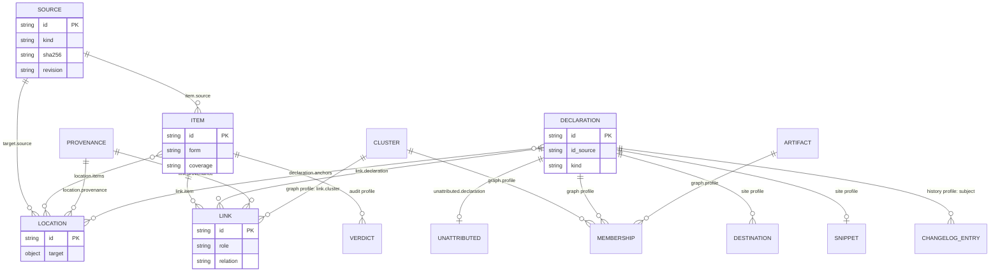

# The formal-companion annotation format, version 1.0

**Status.** Release candidate of format version 1.0. This document is the
normative specification. The schema (`schema/annotations-v1.0.schema.json`),
the reference checker (`src/formal_companion_annotations/validate.py`), the
id algorithm (`docs/id-algorithm.md`), the vocabulary (`docs/vocabulary.md`)
and the test suite (`conformance/`) implement it.

**Conventions.** The key words MUST, MUST NOT, SHOULD, SHOULD NOT and MAY are
to be interpreted as described in RFC 2119. Every section is normative unless
its heading says "Informative". Code spans name literal keys and values.
"The checker" means any conforming checker (section 11). Invariant codes (I1
to I14) are defined in section 9 and cited from earlier sections.

## 1. Introduction

### 1.1 Purpose

A companion repository formalises a written source, item by item. This format
records, in one JSON document per companion, which declarations state which
items of which editions, and where each item sits in its source. A PDF
overlay, a web page, an audit tool and a diff of two companions can then
read and write the same file.

### 1.2 Scope

The format covers pinned sources of several media, numbered items and
unnumbered passages, declarations and their ids, links from items to
declarations with provenance, and locations as W3C Web Annotation targets.
Four optional profiles add a companion's dependency graph, a rendered site,
an audit and an id history.

### 1.3 Non-goals

The format is not:

- a blueprint format, or a dependency-graph format of its own. The `graph`
  profile pins a companion's own dependency graph and records its coarse
  nodes; it does not replace it.
- a store of source text. A document holds only short anchoring quotes.
- a proof checker. A document says which declaration states an item and, in
  the `audit` profile, what an audit concluded. It proves nothing.
- any tool's internal checkpoint format. A document is an exchange file.

### 1.4 Design rules

1. **Everything that varies is an abstraction.** A location is a W3C Web
   Annotation target; every medium uses the same record with a different
   selector. The lists of fragment grammars and media types are open.
2. **No one-item-per-page rule.** An unnumbered passage is a first-class
   item. Items MAY share a page. One item MAY have many locations.
3. **Highly structured.** Every root key is a fixed header or an array of
   records. Every record has a string `id`. Every record array is sorted by
   `id`. Every object is closed. Unions are discriminated (a selector by
   `type`, an item by `form`). The only open door is the `x_` extension key.
4. **Pinned sources.** A source names its bytes (`sha256`, `git_blob`, or a
   site's page manifest), an immutable `revision`, or, for a PDF whose bytes
   the producer does not hold, its edition (`identifiers`). A URL is
   optional.
5. **Plain JSON on disk, JSON-LD on export.** The file is not JSON-LD, but
   its `target` objects export to a W3C `AnnotationPage` without loss
   (section 14).

## 2. Terminology

| term | meaning |
|---|---|
| companion | a repository of Lean code that formalises one or more sources, named at one commit by the `companion` header |
| source | one pinned edition of a work, or one pinned site, file or medium: a `sources[]` record |
| edition | the exact bytes or revision a source pins (section 13) |
| item | a unit of a source that a declaration can state: an `items[]` record |
| numbered item | an item the source numbers (`form: numbered`): a definition, theorem, exercise, equation |
| passage | an item the source does not number (`form: passage`): a remark, a paragraph, a proof step |
| declaration | one Lean declaration or structure member: a `declarations[]` record |
| anonymous declaration | a declaration Lean gives no name: an `example`, or an `instance` without a name |
| link | an attribution of one item to one declaration (or, in the `graph` profile, one cluster): a `links[]` record |
| key link | a link with `role: key`: the declaration states the whole item |
| location | where an item, or a declaration's own text, sits in a source: a `locations[]` record with a W3C target |
| selector | one way of naming a span inside a source, in a location's `target.selector` list |
| provenance | how links, locations or memberships were produced: a `provenance[]` record |
| profile | an optional, separately versioned group of root arrays and fields (section 8) |
| producer | a program or person that writes a document |
| reader | a program that consumes a document |
| checker | a program that decides whether a document is valid (section 9) |
| canonical form | the one byte sequence that represents a document (section 10) |
| extension key | a key matching `^x_[a-z0-9_]+$` on a record, `companion` or the root, carrying a producer's own data |
| live id | an id that a record in the document carries now |

## 3. Data model overview

### 3.1 Records and how profiles attach

Arrows read from the record that holds the reference. Labels name the
referencing field, or the profile that adds the record.



### 3.2 A minimal complete document

The document below is valid. Its keys are in canonical order (section 10);
the layout is compacted for reading, and `--print-canonical` writes the
canonical layout.

```json
{
  "companion": {"commit": "ed00b5dc6b11040ed2f9baf475edc9b48e1c7f4a",
                "generated_at": "2026-09-26T12:00:00Z", "generator": "hand",
                "name": "notes-companion", "repo": "git.example.org/example/notes-companion"},
  "declarations": [
    {"anonymous": false, "file": "Notes/Basic.lean", "id": "Notes.Box.volume_nonneg",
     "id_source": "name", "kind": "theorem", "line": 41, "module": "Notes.Basic",
     "name": "Notes.Box.volume_nonneg", "private": false}
  ],
  "items": [
    {"form": "numbered", "id": "lemma-1.2", "id_source": "label", "kind": "Lemma",
     "number": "1.2", "pages": {"basis": "printed", "first": 5}, "source": "notes-pdf"}
  ],
  "links": [
    {"declaration": "Notes.Box.volume_nonneg", "id": "lemma-1.2/key/Notes.Box.volume_nonneg",
     "item": "lemma-1.2", "provenance": "prov-curation", "role": "key"}
  ],
  "provenance": [
    {"actor": "human", "confirmed_by_human": true, "id": "prov-curation", "method": "curation"}
  ],
  "schema": "formal-companion/annotations",
  "schema_version": "1.0",
  "sources": [
    {"id": "notes-pdf", "kind": "pdf",
     "sha256": "e45a0b99dd11778aac792ecd226d150a9d28b82c9e2897510f441235956a3b07",
     "title": "Elementary Sets: Lecture Notes (synthetic)"}
  ]
}
```

## 4. The document

### 4.1 Root keys

| key | required | type / values | meaning |
|---|---|---|---|
| `schema` | yes | `"formal-companion/annotations"` | the format identifier; no other value is accepted |
| `schema_version` | yes | `"1.<minor>"` | the core minor the producer used (section 12) |
| `profiles` | no | object; keys among `audit`, `graph`, `history`, `site`; values `"1.<minor>"` | the profiles used (4.2); MAY be empty |
| `$schema` | no | string | never fetched; SHOULD be the declared minor's schema `$id` (12.5), else warning `W-SCHEMA-ID` |
| `companion` | yes | object (4.3) | the repository and commit described |
| `sources` | yes, at least one | source (5.1) | the editions annotated |
| `items` | yes | item (5.2) | numbered items and passages |
| `declarations` | yes | declaration (5.3) | every declaration anything names |
| `links` | yes | link (5.4) | attributions of items to declarations |
| `provenance` | yes | provenance (5.6) | how links, locations and memberships were produced |
| `locations` | no | location (5.7) | where items and declarations sit in a source |
| `unattributed` | no | unattributed (5.8) | declarations tied to no item |
| `clusters`, `memberships`, `artifacts` | no; `graph` | 8.1 | a companion's coarse nodes and their members |
| `destinations`, `snippets` | no; `site` | 8.2 | where declarations are rendered; their statement text |
| `verdicts` | no; `audit` | 8.3 | adjudicated verdicts on items |
| `changelog` | no; `history` | 8.4 | id events |
| `x_*` | no | any | extension keys (4.4) |

Each array holds records of the named type. A required array MAY be empty.
An absent optional array means "this document does not say".

### 4.2 Core and profiles

The **core** is the header (`schema`, `schema_version`, `profiles`,
`$schema`, `companion`) and the arrays `sources`, `items`, `declarations`,
`links`, `provenance`, `locations` and `unattributed`. Everything else belongs
to one of four **profiles**. A document declares each profile it uses in the
root `profiles` object, with that profile's own version:

```json
{"audit": "1.0", "graph": "1.0", "history": "1.0", "site": "1.0"}
```

Each profile is versioned separately from the core. A release MAY add to one
profile, raising its minor, without changing `schema_version`. This table is
the complete list of what a profile owns.

| profile | root arrays | fields it owns on other records |
|---|---|---|
| `graph` | `clusters`, `memberships`, `artifacts` | `companion.graph`; `item.clusters`; a link's `cluster` target; `declaration.unlocated`; a destination's `artifact` target |
| `site` | `destinations`, `snippets` | none |
| `audit` | `verdicts` | none |
| `history` | `changelog` | `link.orphaned`; `declaration.replaced_by` |

A source's `role` (5.1) is core, not an `audit` field: a document with no
verdicts MAY still say which source it audits or keeps as a reference.

**I14 (profile gating).** A root array or field that a profile owns MUST NOT
appear unless the document declares that profile. A destination with an
`artifact` target needs both `site` and `graph`. A declared profile with none
of its keys present is valid. A `~k` statement-hash id needs an
`ordinal_assigned` changelog entry (7.1.3), hence the `history` profile.

A reader that does not implement a profile MUST ignore that profile's arrays
and fields and MUST NOT fail because of them (section 11).

### 4.3 The companion header

| field | required | type / values | meaning |
|---|---|---|---|
| `name` | yes | `^[A-Za-z0-9][A-Za-z0-9._-]*$` | the companion's short name |
| `repo` | yes | `host/org/name`, no scheme | the repository |
| `commit` | yes | full git id: 40 or 64 hex | the commit the declarations describe |
| `generated_at` | yes | UTC timestamp | when the document was written |
| `generator` | yes | string | the tool and version that wrote it, or `"hand"` |
| `toolchain` | no | string | the Lean toolchain, e.g. `"leanprover/lean4:v4.24.0"` |
| `packages` | no | array of `{name, rev}`, sorted by `name`, unique names; MAY be empty | dependencies; `rev` is a full git id, `name` a non-empty string |
| `graph` | no; `graph` profile | `{path, sha256, bytes?, snapshot_commit?}` | the companion's own dependency graph, pinned (8.1) |

### 4.4 Extension keys

Extension keys exist only on records (the objects in the root arrays), on
`companion` and on the root. There, a key matching `^x_[a-z0-9_]+$` MAY carry
any value. It is a producer's own data; the checker MUST NOT read it, except
under the opt-in lint L1 (9.5). No other object takes extension keys, so a
nested key that matches the pattern (`coordinate_space.x_axis`) is a core
key. A reader that strips extension keys MUST strip them from those three
places only. A key that several producers need belongs in the next minor.

## 5. Core records

Every enum below is defined, value by value, in `docs/vocabulary.md` and in
`src/formal_companion_annotations/vocab.py`. Every record here and in
section 8 also takes extension keys (4.4). "Sorted set" means a sorted,
duplicate-free array (I2).

### 5.1 Sources

| field | required | type / values | meaning |
|---|---|---|---|
| `id` | yes | id | |
| `kind` | yes | `pdf`, `web`, `tex`, `lean`, `other` | the medium; `other` names it in `media_type` |
| `media_type` | with `kind: other` | IANA media type, lower case, no parameters | e.g. `text/markdown`, `video/mp4` |
| `scope` | no | `page` (default), `site` | `site`: one `web` source for a whole rendered site |
| `title` | yes | string | |
| `edition` | no | string | the edition as the source names it |
| `identifiers` | see identity | object (below) | bibliographic identifiers; the identity of a `pdf` or `other` source whose bytes the producer does not hold |
| `sha256` | see identity | 64 hex | the bytes; for a site, the page manifest |
| `bytes` | no | integer >= 0 | the file's size |
| `git_blob` | see identity | 40 or 64 hex | the git blob id (the core of a Software Heritage `swh:1:cnt` identifier) |
| `url` | no | `http(s)` URL | where the bytes were fetched |
| `alternate_urls` | no | sorted set of `http(s)` URLs | other addresses of the same bytes |
| `revision` | see identity | string | an immutable revision: a wiki `oldid`, a git commit, an edition stamp |
| `retrieved_at` | no | UTC timestamp | when fetched; never an identity |
| `path` | no | repo path | the file or site root, relative to the companion's repository |
| `page_hashes` | site sources only; required with `sha256` | array of `{path, sha256}`, at least one, sorted by `path` | the pinned pages of a site |
| `physical_page_count` | no; PDF only | integer >= 1 | |
| `printed_page_offset` | no; PDF only | integer | physical page = printed page + offset |
| `page_size` | no; PDF only | `{width_pt, height_pt}`, each >= 1 | the page box in points |
| `page_sizes` | no; PDF only | array of `{first, last, width_pt, height_pt}`, at least one, sorted by `first` | pages whose size differs from `page_size` |
| `text_layer` | no | object (6.7) | how quotes on this source are matched |
| `role` | no | `audited`, `reference` | what the source is for (below) |

**Identity.** A `pdf` source MUST carry `sha256` or `identifiers`: the bytes,
or the edition (a DOI, ISBNs or an arXiv id) when the producer does not hold
the bytes. A `web` source MUST carry `sha256` or `revision`. A `tex` or
`lean` source MUST carry `sha256` or `git_blob`. An `other` source MUST carry
`media_type` and `sha256`, `git_blob`, `revision` or `identifiers`. A source
that names no bytes (neither `sha256` nor `git_blob`) still has pages: the
page fields, `pages` and `page=` fragments apply to it, but a
`PdfRegionSelector` MUST NOT be used on it (6.4, I7).

**Identifiers.** `identifiers` MUST carry at least one of these keys and no
other:

| field | required | type / values | meaning |
|---|---|---|---|
| `doi` | no | `^10\.[0-9]{4,9}/[!-~]+$` | a DOI |
| `isbn` | no | array of ISBN-13 `^97[89][0-9]{10}$`, at least one, sorted, unique | ISBNs of this edition |
| `arxiv` | no | `^[0-9]{4}\.[0-9]{4,5}v[1-9][0-9]*$` or `^[a-z][a-z-]*(\.[A-Z]{2})?/[0-9]{7}v[1-9][0-9]*$` | an arXiv id with its version |

**PDF pages.** The page fields apply only to a PDF: `kind: pdf`, or `other`
with `media_type: application/pdf`. A page's size is its `page_sizes` range
when one lists it, else `page_size`. `page_sizes` ranges MUST be ordered,
disjoint and within `physical_page_count` when it is given.

**Site sources.** A `site` source MUST have `kind: web`, and each of its
locations names its page with a `SitePageSelector` (6.5). Its `sha256` is
defined over the pages listed in `page_hashes`. It is the sha256 of the
UTF-8 manifest with one line `"<sha256 of the page's bytes>  <path>\n"` per
listed page (two spaces, as `sha256sum` writes). The lines are ordered by
`path` in the section 10 order. A site source with `sha256` MUST carry `page_hashes`, and
the checker MUST recompute the digest from it. The producer chooses the
pages it pins, but `page_hashes` MUST list every page a `SitePageSelector`
on the source names (a selector path ending in `/` names its `index.html`).
Pages that only a destination's `href` names need not be listed. A
`page_hashes[].path` uses the `site_path` grammar (6.5) and names a file: it
MUST NOT end in `/`. `validate.site_sha256` is the reference implementation.

**Text layer.** `text_layer.extractor` and `version` come together: both or
neither.

**Role.** `role` says what the source is for: `audited` (a companion is
checked against it) or `reference` (kept only so that a page map to a
sibling edition can be checked, and audited against by nobody). It is a core
field: a document with no verdicts (8.3) MAY still carry it.

### 5.2 Items

| field | required | type / values | meaning |
|---|---|---|---|
| `id` | yes | id | formed as `id_source` says (7.2) |
| `id_source` | yes | `label`, `quote_hash`, `page_title_hash`, `declared` | how the id was formed |
| `form` | yes | `numbered`, `passage` | the discriminator |
| `source` | yes | source id | the edition the item is in |
| `kind` | yes | string | `Definition`, `Exercise`, ...; `passage` for unlabelled prose |
| `kind_source` | no | `source` (default), `producer` | whose word `kind` is |
| `number` | numbered only | `^[0-9A-Za-z]+(\.[0-9A-Za-z]+)*$` | the source's number, e.g. `1.1.21` |
| `sub` | no; numbered only | `^[0-9A-Za-z]+'*([.,-][0-9A-Za-z]+'*)*$` | a part the source sets out separately, without parentheses: `ii`, `3`, `ix,x`, `b'`; a prime (U+0027) stays |
| `title` | no; required on a passage | string | the item's title |
| `title_source` | no | `source` (default), `producer` | whose words `title` is |
| `label` | no | string | the label as the source prints it |
| `section` | no | string | the source's own section, as the source names it |
| `pages` | no; required for `page_title_hash` | pages (5.5) | a page span without geometry |
| `quote` | no | `{exact, prefix?, suffix?}` | a quote that anchors the item on its whole source |
| `coverage` | no | see below | the curator's class for the item |
| `coverage_note` | no; needs `coverage` | string | the curator's note on the class |
| `clusters` | no; `graph` profile | sorted set of cluster ids | the coarse nodes the item belongs to |
| `relations` | no | `{same_as?, part_of?, near?}`, at least one key, each a sorted set of item ids | typed relations to other items |
| `xrefs` | no | array of `{database, tag}`, at least one, unique, sorted by `(database, tag)` | the same statement in a public database |
| `legacy_ids` | no | sorted set of strings | ids the item had in older formats |

**Forms.** A numbered item MUST carry `number`. A passage MUST carry `title`
and MUST NOT carry `number` or `sub`. `kind: passage` implies
`form: passage`; `id_source: label` implies `form: numbered`, and
`quote_hash` or `page_title_hash` implies `form: passage`.
`(source, kind, number, sub)` MUST be unique among numbered items (I6). A
passage's `kind` is `passage`, or a word such as `Remark` when the source or
producer labels it without a number.

**Anchors.** A numbered item is located by its number alone: it MAY have no
location, `quote` or `pages`. A passage MUST have at least one of them (I4).

**Coverage.** `coverage` is one of:

| value | meaning |
|---|---|
| `formalized` | a `key` link states the item in full; the declaration MAY be an anonymous `example` |
| `partial_only` | the linked declarations state a special case or one part of the item, and none states all of it |
| `support_only` | the only linked declarations state a neighbouring item |
| `example_only` | the only declarations that state it are anonymous `example` declarations, and the producer links them with role `example`, not `key` |
| `private_only` | only a private declaration states it |
| `not_formalized` | nothing in the companion states it |
| `out_of_scope` | the companion does not set out to formalise it |

I5 (5.4) ties `coverage` to links. An anonymous `example` MAY be a `key`
link's target: it then states the item, and the item is `formalized` (or
carries no `coverage`), not `example_only`. `coverage_note` MUST NOT appear
without `coverage`. An item with `clusters` and no links is shown through
its clusters; no flag says so.

**Quote.** `quote` is shorthand for a location on the item's source with one
`TextQuoteSelector` and no page; a reader MAY expand it so. A quote verified
only within one page belongs on a location, not in `item.quote`.

**Xrefs.** `database` is an open lower-case snake_case token
(`^[a-z][a-z0-9_]*$`) with a documented core: `stacks`, `kerodon`,
`wikidata`, `lmfdb`. Another token passes with warning `W-XREF`. `tag` is a
non-empty string without whitespace. An xref says the item is the same
mathematical statement as that database entry; it is the cross-source
pairing key (section 13).

**Relations.** `same_as` is the same content (an entry in another edition or
an errata list). `part_of` is containment. `near` is placement by a
neighbour, from which a passage's page MAY be inferred (`pages.anchor:
inferred`). An item MUST NOT relate to itself (I3).

### 5.3 Declarations

| field | required | type / values | meaning |
|---|---|---|---|
| `id` | yes | id | formed as `id_source` says (7.1) |
| `id_source` | yes | `name`, `private`, `statement_hash`, `declared` | how the id was formed |
| `name` | see 7.1 | string | the declared, fully qualified name; absent on an anonymous declaration |
| `lean_name` | no | string | the name Lean gives it when that differs: a generated instance name, a `_private` name |
| `namespace` | no | `""` or a dotted name | the enclosing namespace; `""` for the root |
| `signature` | no | string | the display form of the header (7.1.2) |
| `kind` | yes | `theorem`, `lemma`, `def`, `abbrev`, `structure`, `class`, `inductive`, `instance`, `example`, `opaque`, `axiom`, `alias`, `irreducible_def`, `field`, `projection`, `constructor`, `recursor` | the Lean keyword, or the member kind |
| `parent` | members only | declaration id | the structure, class or inductive the member belongs to |
| `package` | no | `^[A-Za-z0-9_-]+$` | a Lake package other than the companion; `file` is then relative to it |
| `module` | yes | dotted module name | |
| `file` | yes | repo path ending in `.lean` | |
| `line` | no | integer >= 1 | the keyword's line; never part of the id |
| `doc_line` | no | integer >= 1 | the docstring's first line |
| `private` | yes | boolean | |
| `anonymous` | yes | boolean | |
| `unlocated` | no; `graph` profile | boolean | a declared id not yet found in the Lean (8.1) |
| `sorry` | no | `none`, `exercise`, `gap` | whether the proof holds a `sorry`, and why |
| `statement_sha256` | no; required on an anonymous declaration unless `unlocated` | 64 hex | the statement hash of the signature's hash form (7.1.2); a named declaration MAY carry the hash of its `signature` |
| `anchors` | no | sorted set of location ids | locations that show the declaration's own text |
| `replaced_by` | no; `history` profile | declaration id | the declaration that supersedes this one |
| `legacy_ids` | no | sorted set of strings | ids the declaration had in older formats |

**Kinds and parents.** `field` and `projection` name their `structure` or
`class` in `parent`. `constructor` and `recursor` name their `inductive`,
`structure` or `class`. No other kind carries `parent`. A declaration MUST
NOT be its own parent. For every member kind, `namespace` MUST equal the
parent's full name, and the member's full name MUST be that namespace, a dot
and its own name (one component: the own name holds no dot). The full name
is `name` when present, else the id of a
`name` declaration, else the name part of a `private` id.

**Anonymous declarations.** `kind: example` is always anonymous; a named
example MUST be refused (I8). An anonymous declaration MUST have kind
`example` or `instance`, MUST carry `statement_sha256` unless `unlocated`,
and MUST NOT carry `name`. Its `id_source` is `statement_hash` or `declared`.

**Other fields.** `signature` is omitted when no `:=`, top-level `where` or
match-alternative line ends a typed header (so an `axiom` never has one),
and for a `structure`, `class` or `inductive`. `ids.signature_at` makes the
same cut for a named declaration, which MAY carry the `signature` and
`statement_sha256` it returns; I8 checks them as it does for an anonymous
declaration.
`anchors` lists locations on a `lean` or `web` source, or on an `other`
source with media type `text/*` or `application/xhtml+xml`; never on a
`tex`, PDF or other source (I7).

### 5.4 Links

| field | required | type / values | meaning |
|---|---|---|---|
| `id` | yes | id | recommended `<item>/<role>/<target>` |
| `item` | yes | item id | |
| `declaration` | one of the two | declaration id | the target |
| `cluster` | one of the two; `graph` profile | cluster id | the target (8.1) |
| `role` | yes | `key`, `attributed`, `support`, `example`, `helper` | what the link claims |
| `relation` | no | `^[a-z][a-z0-9_]*$` | how the declaration relates to the item's text |
| `note` | no | string | a short free-text note |
| `sub` | no | as `item.sub` | the part of the item the link covers |
| `pages` | no | pages (5.5) | the page the link's own tag gives; MAY differ from the item's |
| `locations` | no | sorted set of location ids | locations for this link alone, on the item's source |
| `provenance` | yes | provenance id | |
| `raw_label` | no | string | the companion's own tag, verbatim |
| `orphaned` | no; `history` profile | boolean | the declaration id was retired and nobody re-attached the link (8.4) |

**Roles.** `key`: the declaration states the whole item. `attributed`: shown
for the item, not key. `support`, `example`, `helper`: a supporting result,
a worked example, a helper used in the proof.

**Relation.** The core tokens are `exact`, `generalization`, `special_case`,
`part` (the declaration states one part of the item), `invocation` and
`related`. Another token that fits the pattern passes with warning
`W-RELATION`.

**Uniqueness.** `(item, target, role, sub)` MUST be unique among links,
whatever the ids are (I3). A link's `sub` never splits the item.

**I5 (coverage and links).** These rules count only non-orphaned links:

1. A `key` link says the declaration states the whole item, whatever its
   kind: an anonymous `example` MAY be the target.
2. An item with links and no `key` link MUST carry `coverage`.
3. An item with an `attributed` link MUST have a `key` link, unless its
   `coverage` is `partial_only`. Then the `attributed` links are the partial
   statements, and their `relation` SHOULD be `special_case` or `part`.
4. A `formalized` item MUST have a `key` link. A `partial_only`,
   `support_only`, `example_only`, `not_formalized` or `out_of_scope` item
   MUST NOT have a `key` link. A `private_only` item MUST have at least one
   link, and each of its `key` links MUST name a declaration with
   `private: true`.
5. A `not_formalized` or `out_of_scope` item MUST NOT have a link with role
   `key` or `attributed`; `support`, `example` and `helper` links are
   allowed.
6. `coverage_note` MUST NOT appear without `coverage`.

### 5.5 Pages

| field | required | type / values | meaning |
|---|---|---|---|
| `first` | yes | integer >= 1 | |
| `last` | no | integer >= `first` | defaults to `first` |
| `basis` | yes | `printed`, `physical` | which numbering `first` and `last` use |
| `anchor` | no | `own`, `crossref`, `inferred` | the thing's own anchor, a cross-reference to it, or a neighbour |
| `raw` | no | string | the anchor text as written, e.g. `book pp. 25-26` |

`pages` appears on items, links and locations, always about a PDF source
(I6). Physical page = printed page + `printed_page_offset`. Every physical
page named MUST be >= 1 and within `physical_page_count` when the source
gives it. On a location, `pages` mirrors the selectors, which MUST name no
page outside it (I7).

### 5.6 Provenance

| field | required | type / values | meaning |
|---|---|---|---|
| `id` | yes | id | |
| `actor` | yes | `author`, `agent`, `human`, `tool` | who produced the records |
| `method` | yes | `docstring_tag`, `curation`, `blueprint_macro`, `lean_scan`, `layout_extraction`, `text_match`, `manual`, `agent_annotation`, `pipeline`, `adjudication`, `site_index` | how |
| `agents` | no | sorted set of strings | the agents involved |
| `tool` | no | `{name, version?, path?}` | the program; `path` is a repo path |
| `inputs` | no | array of inputs, at least one, sorted | what the producer read |
| `confirmed_by_human` | yes | boolean | |
| `at` | no | date or UTC timestamp | |
| `note` | no | string | |

An **input** is a file of the companion, `{path, sha256, bytes?, commit?}`,
or a source of this document, `{source}`; never both shapes. File entries
come first, sorted by `path`, then source entries sorted by `source`, one
entry each (I2).

### 5.7 Locations

| field | required | type / values | meaning |
|---|---|---|---|
| `id` | yes | id | recommended `<item>@p<page>` for a PDF location |
| `items` | yes | sorted set of item ids; MAY be empty | the items the location shows |
| `target` | yes | `{source, selector}` (6.1) | the W3C target |
| `pages` | no | pages (5.5) | a structured mirror of the selectors |
| `provenance` | no | provenance id | |
| `signoff` | no | object (below) | who checked the location against the source |
| `legacy_ids` | no | sorted set of strings | |

The location's source is `target.source`; there is no second copy. Every item
a location shows MUST be on that source. A location with no items MUST be
named by a declaration's `anchors` or by a link's `locations` (I7).

| signoff field | required | type / values | meaning |
|---|---|---|---|
| `method` | yes | string | how it was checked |
| `verifier` | yes | string | who checked |
| `evidence_id` | no | string | the producer's own id for the evidence |
| `evidence_sha256` | no | 64 hex | |
| `at` | no | date or UTC timestamp | |

### 5.8 Unattributed

| field | required | type / values | meaning |
|---|---|---|---|
| `id` | yes | id | |
| `declaration` | yes | declaration id | |
| `claim` | yes | `unattributed`, `api`, `infrastructure` | why it is tied to no item |
| `signals` | no | sorted set of strings | what suggested the claim |

An unattributed declaration MUST have no non-orphaned link (I13).

## 6. Locations and selectors

### 6.1 The target

`target` is a W3C `SpecificResource`:

| field | required | type / values | meaning |
|---|---|---|---|
| `source` | yes | source id | the location's source; an exporter replaces it with the source's IRI |
| `selector` | yes | array of selectors, at least one | alternatives in preference order |

`selector` is always a list of **alternatives**: each selects the same span,
and a reader uses the first it understands. It is never a union. An item
that spans two pages is two locations. `refinedBy` (one selector) narrows
its parent: a quote inside `page=7`, an element id inside a site page.
Selector keys use the W3C spelling (`conformsTo`, `refinedBy`); the two
extension selectors use snake_case.

### 6.2 Selector types and families

Each source follows the rules of one **family**. `pdf` is kind `pdf`, or
`other` with `application/pdf`. `html` is kind `web`, or `other` with
`text/html` or `application/xhtml+xml`. `text` is kind `tex` or `lean`, or
`other` with any other `text/*` type. `generic` is any other medium. The five
selector types of version 1.0:

| selector | fields besides `type` | pdf | html | text | generic |
|---|---|---|---|---|---|
| `FragmentSelector` | `conformsTo?`, `value`, `refinedBy?` | yes | yes | yes | yes |
| `TextQuoteSelector` | `exact`, `prefix?`, `suffix?`, `refinedBy?` | yes | yes | yes | yes |
| `CssSelector` | `value`, `refinedBy?` | no | yes | no | yes |
| `PdfRegionSelector` (extension) | `page`, `coordinate_space`, `rect` or `quads` | yes | no | no | no |
| `SitePageSelector` (extension) | `path`, `refinedBy?` | no | site sources only | no | no |

A `FragmentSelector.value` is the fragment without its leading `#`. A
`TextQuoteSelector.exact` and a `CssSelector.value` are non-empty. A selector
type outside this table MUST be refused; the schema refuses it, so the code
is `SCHEMA` (I7 covers a known type on a source of the wrong family).

### 6.3 Fragment grammars

`conformsTo` is open. These IRIs get a grammar check; any other IRI passes
with warning `W-CONFORMS` and its value is not checked. A `FragmentSelector`
without `conformsTo` also passes with `W-CONFORMS`. The IRIs are identifiers
and MUST NOT be fetched.

| IRI | grammar | families |
|---|---|---|
| `http://tools.ietf.org/rfc/rfc8118` | PDF fragment | pdf |
| `http://tools.ietf.org/rfc/rfc3778` | the same; RFC 8118 obsoletes RFC 3778 with the same parameters | pdf |
| `http://tools.ietf.org/rfc/rfc5147` | text lines and characters | text |
| `http://tools.ietf.org/rfc/rfc3236` | an HTML element id | html |
| `http://www.w3.org/TR/media-frags/` | Media Fragments `xywh=`, `t=`, `track=`, `id=` | html, generic |

A known IRI on a source of another family MUST be refused. In every grammar,
a number is written in ASCII digits only, and an integer has at most 9
digits.

- **RFC 8118 (and RFC 3778).** `&`- or `#`-separated `name=value` parameters
  with `name` among `page`, `nameddest`, `structelem`, `comment`, `ef`,
  `zoom`, `view`, `viewrect`, `highlight`, `search`, `fdf`. A parameter MUST
  NOT repeat (`page=999&page=7` is refused). `zoom` takes 1 or 3 numbers,
  `viewrect` 4, `highlight` 4 with left <= right and top <= bottom. `page` is
  a positive integer within `physical_page_count`. A PDF fragment that is
  refined MUST name its `page=`.
- **RFC 5147.** `char=` or `line=`, then a position or a range `a,b`, `a,`
  or `,b`, then any number of `;length=N[,charset]` or `;md5=<32 hex>`. In
  a range, `a < b`; an empty or reversed range MUST be refused.
- **RFC 3236.** An element id: at least one character, no whitespace, no
  `#`.
- **Media Fragments.** `&`-joined dimensions. `xywh=[pixel:|percent:]x,y,w,h`
  takes integers, `w` and `h` positive, a `percent:` region within 100.
  `t=[npt:]start[,end]` or `t=[npt:],end` takes times `sec[.f]`, `mm:ss[.f]`
  or `h:mm:ss[.f]`, start before end. `track=` and `id=` take a name without
  whitespace. A name that is no dimension, and a repeated dimension (the
  last one wins), are warnings, `W-MEDIA`.

### 6.4 PdfRegionSelector

The W3C model has no rectangle selector for PDF pages; this one fills the
gap.

| field | required | type / values | meaning |
|---|---|---|---|
| `page` | yes | integer >= 1 | the 1-based physical page |
| `coordinate_space` | yes | object (below) | |
| `rect` | one of the two | `{x0, y0, x1, y1}` | a rectangle, `x0 < x1`, `y0 < y1` |
| `quads` | one of the two | array of `{x0, y0, x1, y1, x2, y2, x3, y3}`, at least one | quadrilaterals, corners in drawing order |

| `coordinate_space` field | required | type / values | meaning |
|---|---|---|---|
| `origin` | yes | `top_left`, `bottom_left` | |
| `units` | yes | `normalized`, `pt` | fractions of the page box, or points |
| `x_axis` | yes | `right` | |
| `y_axis` | yes | `down`, `up` | `top_left` goes with `down`, `bottom_left` with `up` |
| `page_box` | yes | `MediaBox`, `CropBox`, `BleedBox`, `TrimBox`, `ArtBox` | the box the coordinates are relative to |

Coordinates MUST be finite. `normalized` coordinates MUST lie in [0, 1].
`pt` coordinates MUST be >= 0 and within the page's size when the source
gives it. A quad MUST have at least three distinct corners, and they MUST
NOT all lie on one line. `page` MUST be within `physical_page_count` when it
is given. Coordinates are objects because JSON-LD flattens nested arrays.

The region is measured on the bytes, so the source MUST name them: `sha256`
or `git_blob` (I7). A source pinned by `identifiers` alone (5.1) has pages
but no bytes; locate on it with a `page=` fragment and `pages`.

### 6.5 SitePageSelector

One rendered site is one source, not one source per page.

| field | required | type / values | meaning |
|---|---|---|---|
| `path` | yes | `site_path` | the page, relative to the site root; a path ending in `/` names its `index.html` |
| `refinedBy` | no | selector | the place on the page |

The `site_path` grammar: no leading slash, no `..` segment, no `#`, no `:`,
no whitespace. On a `scope: site` source, every top-level alternative MUST
be a `SitePageSelector`. When the source has `page_hashes`, the page MUST be
listed there (5.1).

### 6.6 Placement rules

The checker tracks each selector's structural parent: none for a top-level
alternative, else the selector it refines.

- A `PdfRegionSelector` MUST be a top-level alternative or the direct
  refinement of a PDF `page=` fragment. In the second case its `page` MUST
  be that page.
- A `page=` fragment inside another `page=` fragment MUST name the same
  page.
- A `SitePageSelector` MUST be a top-level alternative on a site source and
  MUST NOT appear anywhere else.
- A `refinedBy` chain MUST be at most 8 selectors deep.

### 6.7 Text layers and units

A quote (`TextQuoteSelector`, `item.quote`) is matched under the source's
`text_layer`:

| field | required | type / values | meaning |
|---|---|---|---|
| `extractor` | with `version` | string | the program that produced the text, e.g. `pdftotext` |
| `version` | with `extractor` | string | its version |
| `unicode` | yes | `none`, `nfc`, `nfkc` | normalisation before matching |
| `whitespace` | yes | `exact`, `collapse`, `ignore` | how whitespace is compared |
| `case` | yes | `sensitive`, `insensitive` | |

A PDF has no single text layer: two extractors give different text for the
same passage. So quote prose, not formulas. `nfkc` with whitespace ignored
reconciles ligatures and the micro sign against Greek mu. Recording the
matcher makes re-anchoring after a new revision mechanical.

RFC 5147 `char=` positions count **Unicode code points**, and a range is
half-open. Lean's `String.Pos` counts bytes and the language server counts
UTF-16 units; with astral characters the three differ, so a producer MUST
convert before writing a `char=` fragment. RFC 5147 positions are zero-based
points between units, so editor lines 42 to 47 are `line=41,47`.

### 6.8 One example per location kind

All values are synthetic. Each block is a location's `target`, less its
`source`. Whole documents, one per kind of source, are in
`examples/annotations/`.

**A region of a PDF page**, with a lossy standard fallback (`highlight=` is
left, right, top, bottom in points from the top-left corner) and a quote:

```json
{"selector": [
  {"type": "PdfRegionSelector", "page": 7,
   "coordinate_space": {"origin": "top_left", "units": "normalized", "x_axis": "right",
                        "y_axis": "down", "page_box": "CropBox"},
   "rect": {"x0": 0.147059, "y0": 0.176768, "x1": 0.852941, "y1": 0.328283}},
  {"type": "FragmentSelector", "conformsTo": "http://tools.ietf.org/rfc/rfc8118",
   "value": "page=7&highlight=90,522,140,260"},
  {"type": "FragmentSelector", "conformsTo": "http://tools.ietf.org/rfc/rfc8118", "value": "page=7",
   "refinedBy": {"type": "TextQuoteSelector", "exact": "Definition 1.1 (Boxes).",
                 "suffix": " A box is a product of"}}
]}
```

**A page of a PDF, nothing finer**, with the page also given structurally as
`"pages": {"first": 10, "basis": "physical"}` on the location:

```json
{"selector": [
  {"type": "FragmentSelector", "conformsTo": "http://tools.ietf.org/rfc/rfc8118", "value": "page=10"}
]}
```

**A passage of a web page** pinned by `revision` in its source, by a quote
and by the element that holds it:

```json
{"selector": [
  {"type": "TextQuoteSelector", "exact": "an ideal whose complement is closed under multiplication",
   "prefix": "a prime ideal is ", "suffix": ", and which is not the whole ring"},
  {"type": "CssSelector", "value": "#mw-content-text > p:nth-of-type(2)"}
]}
```

**A page of a rendered site.** The source is `kind: web, scope: site` with a
`path` and a `revision`; the page is chosen by path and the place by its
HTML id:

```json
{"selector": [
  {"type": "SitePageSelector", "path": "Notes/Section_2/",
   "refinedBy": {"type": "FragmentSelector", "conformsTo": "http://tools.ietf.org/rfc/rfc3236",
                 "value": "Notes___sum_le"}}
]}
```

**A line range in a LaTeX file.** Editor lines 42 to 47:

```json
{"selector": [
  {"type": "FragmentSelector", "conformsTo": "http://tools.ietf.org/rfc/rfc5147", "value": "line=41,47"},
  {"type": "TextQuoteSelector", "exact": "\\begin{theorem}\\label{thm:sum-comm}"}
]}
```

**A line range in a Lean file**, used as a declaration's anchor: the
location's `items` is empty and the declaration lists it in `anchors`.
Editor lines 113 and 114:

```json
{"selector": [
  {"type": "FragmentSelector", "conformsTo": "http://tools.ietf.org/rfc/rfc5147", "value": "line=112,114"},
  {"type": "TextQuoteSelector", "exact": "theorem sum_comm", "suffix": " (f : Fin m → Fin n → ℕ) :"}
]}
```

**Other media.** A Markdown file is `kind: other, media_type: text/markdown`
and takes the text rules. An e-book located by an EPUB CFI uses that
grammar's IRI, which the checker does not know (`W-CONFORMS`). A lecture
recording is `media_type: video/mp4` and takes Media Fragments:

```json
{"selector": [
  {"type": "FragmentSelector", "conformsTo": "http://www.w3.org/TR/media-frags/",
   "value": "t=1830,1905&xywh=percent:10,10,80,60"}
]}
```

## 7. Ids

Every record has an `id`: a string of 1 to 256 characters with no
whitespace, unique in its array (I1), and never reused once retired (I9).
Ids of locations and links are free; a recommended shape is given with each
record. Ids of declarations and items follow mechanical rules, recorded in
the record's `id_source`.

This section is a summary. `docs/id-algorithm.md` is the normative algorithm
for every id rule, with the explicit character sets, and `conformance/ids/`
holds its test vectors. Where the two differ, that document decides.

### 7.1 Declaration ids

#### 7.1.1 The four forms

| declaration | `id_source` | id |
|---|---|---|
| named, public or protected | `name` | the fully qualified name |
| `private` | `private` | `private:<module>:<declared full name>` |
| anonymous, no override | `statement_hash` | `example:<12 hex>` or `instance:<12 hex>`, with `~k` for k >= 2 |
| anonymous, with an override | `declared` | `example:<slug>` or `instance:<slug>` |

A `name` id MUST NOT start with `private:`, `example:`, `instance:` or `:`.
The private form includes the module because Lean allows the same private
name in two modules. The flags MUST agree with `id_source`: `name` is
neither private nor anonymous, `private` is private and not anonymous,
`statement_hash` and `declared` are anonymous (I8). A `name` declaration's
`name`, when present, MUST equal its id. A `private` declaration MUST carry
`name`.

**One grammar.** `src/formal_companion_annotations/vocab.py` defines the
anonymous-id grammar once (`HASH_ID_PATTERN`, `DECLARED_ID_PATTERN`);
`src/formal_companion_annotations/ids.py` and `validate.py` both apply it
with full-match semantics. A hash id is `<keyword>:<12 lowercase
hex>` with an optional `~k`, k >= 2. A declared slug is letters of either
case, digits, `.`, `_` and `-`, starting with a letter or digit; a slug of
exactly 12 lowercase hex digits, with or without `~k`, is reserved for hash
ids. The keyword in the id MUST equal the declaration's `kind`.

#### 7.1.2 Display form and hash form

An anonymous declaration has two texts:

- The **display form**, written in `signature`. It is the header text from
  the keyword to the end of the header. Comments and the docstring are
  replaced by one space each; each run of whitespace outside a string or
  character literal is collapsed to one space; the ends are stripped.
  Whitespace here means exactly U+0009, U+000A, U+000D and U+0020.
- The **hash form** `H(signature)`: the display form tokenised and joined
  again. `statement_sha256` is the sha256 of the UTF-8 bytes of the hash
  form. The id is `<keyword>:<first 12 hex of statement_sha256>`.

The header of a typed declaration runs to its `:=`, its top-level `where`,
or a match-alternative line (a line that starts with `|` followed by
whitespace). An untyped header (`example (d : ℕ) := t`) hashes the whole
command up to the next command, since the term decides the proposition.
Where exactly the header ends, which literals are opaque, and which
modifiers and prefixes are recognised, is stated in `docs/id-algorithm.md`.

Tokenising, in brief. A *word character* is an ASCII letter or digit, `_`,
`'`, `!`, `?`, `.`, or a character of Lean's letter-like and subscript
ranges (listed in `docs/id-algorithm.md`). A token is a maximal run of word
characters (a `«…»` identifier joins the run it touches), a whole literal
(kept verbatim), or any other non-whitespace code point on its own. Exactly
two aliases apply: `↦` becomes the symbol `=>`, and `λ` becomes the word
`fun`. Tokens are concatenated with one U+0020 between two adjacent tokens
exactly when each is a word token or a literal: a space only where removing
it would merge two names.

| display form | hash form |
|---|---|
| `example (x : T) : P x`, `example (x:T) : P x`, `example ( x : T ):P x` | `example(x:T):P x` |
| `fun x ↦ x`, `λ x => x` | `fun x=>x` |
| `theorem foo (n : ℕ) : n + 0 = n` | `theorem foo(n:ℕ):n+0=n` |
| `f .foo` versus `f.foo` | `f .foo` versus `f.foo`: distinct |

So a formatting-only edit, a line break or a comment between tokens never
changes the id. The checker MUST verify (I8) that `signature`, when present,
is in display form and that `sha256(H(signature))` equals
`statement_sha256`. It MUST also verify that the id's 12 digits are the
prefix of `statement_sha256`.

#### 7.1.3 Ordinals and their scope

When two anonymous declarations of one companion get the same id (the same
keyword and the same 12 hex digits), the later ones take `~2`, `~3`, and so
on. The duplicates are counted over every `.lean` file tracked by git at
`companion.commit` in the companion's repository. The order is by
repository-relative POSIX path, compared by UTF-16 code units, then by line.
A declaration with a declared id takes no ordinal and shifts none. A caller
of `ids.assign_ids` MUST pass all tracked `.lean` files.

An ordinal is positional, so it is recorded. A `~k` id MUST have an
`ordinal_assigned` changelog entry naming the id, the `commit`, the
declaration's `file` and optionally its `line` (`history` profile). The
latest entry for a live `~k` id MUST name the file the declaration is in.
The latest entry is the one with the greatest `at`; a bare date counts as
the start of its day, 00:00Z. When several latest entries name different
files, the id MUST be refused. An entry whose id a later entry retires or
renames stays valid, as history. `ids.ordinal_ids()` lists the ids that need
an entry.

One document cannot detect a move that keeps every recorded id live in its
recorded file, such as two copies in one file swapping places; only a diff
against the previous document shows it. For a statement that has, or may
get, a textual twin, declare an id.

#### 7.1.4 Declared ids

A declared id is accepted from exactly three places, each holding only the
tag:

- a comment whose whole content is the backticked tag: ``/- `example:<slug>` -/``;
- a `--` line comment holding only the tag;
- a docstring line that is exactly `formal-companion id: <id>`.

The comment MUST start its own line (only whitespace before it); a trailing
comment on a code line never declares. Blank lines, attributes, one-line
`... in` prefixes and other comments MAY sit between the tag and the
declaration. A comment or docstring on the same line before the keyword
(`/-- doc -/ example ...`) is read for a declared id, and its width does not
count as indentation. The tag's keyword MUST match the declaration's. Four
things make a rejected tag: the wrong keyword, a comment that starts like a
tag but carries anything else, a malformed `formal-companion id:` line, and
two tags that name different ids. The declaration then keeps its hash id,
and a producer reports the rejection (`docs/id-algorithm.md` section 12).
`statement_sha256` is still required, so a restatement under a declared id
is logged (8.4) and its links go back for review.

#### 7.1.5 Recommendation

Give a declaration a name when an item needs a stable target. Statement-hash
ids are the fallback for declarations that stay anonymous. A declared id is
for an anonymous declaration that must stay anonymous and needs a stable id.
A Lean attribute was considered and rejected: an unregistered attribute is a
hard error, so it would add a dependency to every companion and a build to
every producer. A comment needs neither.

#### 7.1.6 Known limits

The hash is syntactic. A binder rename, `(a b : T)` versus `(a : T) (b : T)`,
any notation change outside the alias table, and a change of context
(`variable`, `open`, namespace) all retire the id. The optional `namespace`
field records the last of these. A Lean-side extractor hashing elaborated
types would fix them; it is future work, not part of 1.0.

### 7.2 Item ids

| item | `id_source` | id |
|---|---|---|
| numbered | `label` | `<kind>-<number>[-<sub>]`: the kind lower-cased, each run of characters outside `a-z` and `0-9` replaced by one `-`, `-` stripped from the ends; `number` and `sub` verbatim, a prime included; `exercise-1.2.3`, `exercise-1.4-b'` |
| passage with a quote | `quote_hash` | `passage-<first 8 hex of sha256 of the normalised quote>` |
| passage without a quote | `page_title_hash` | `passage-p<printed page>-<first 8 hex of sha256 of the normalised title>` |
| any, with an override | `declared` | any id except the two mechanical passage shapes |

The **normaliser** for quotes and titles is: NFKC, then each run of
whitespace replaced by one U+0020, then whitespace stripped from both ends;
case is kept. Whitespace here is the 25 code points with the Unicode
`White_Space` property: U+0009, U+000A, U+000B, U+000C, U+000D, U+0020,
U+0085, U+00A0, U+1680, U+2000, U+2001, U+2002, U+2003, U+2004, U+2005,
U+2006, U+2007, U+2008, U+2009, U+200A, U+2028, U+2029, U+202F, U+205F,
U+3000. NFKC comes first so that ligatures, the micro sign and no-break
spaces from different PDF extractors give the same id. The hash is the
sha256 of the UTF-8 bytes of the normalised text.

The **quote** is `item.quote.exact` when the item has one. Otherwise it is
the `exact` of the first `TextQuoteSelector` of the item's first location:
locations in id order, alternatives in order, each followed by its
`refinedBy` chain. The **printed page** is `pages.first` on the printed
basis, or the physical page less `printed_page_offset`; it MUST be >= 1. A
passage without a quote and without a derivable printed page MUST be
declared. A quote or title that a mechanical id hashes MUST NOT be only
whitespace (I12).

The same normalised quote on the same source is the same passage: a producer
that meets it twice writes one item with two links. Two different passages
with the same mechanical id are a duplicate-id error (I1); declare one of
them. The 8 hex digits are 32 bits, so such a collision is rare but not
negligible on a large source. By the birthday bound, the chance that some
pair among ten thousand distinct quotes collides is about one in a hundred;
it is about three in a hundred at sixteen thousand and even odds near eighty
thousand. A producer that annotates a text of that size resolves the I1 with
a declared id for one of the two passages. A `label` id needs a kind that
leaves at least one character after slugging; otherwise declare the id. A
mechanical passage id changes with its
quote, or its title and page; that is a `retired` and `born` pair in the
changelog. `ids.item_label_id`, `ids.passage_quote_id` and
`ids.passage_page_id` are the reference implementation.

## 8. Profiles

Every profile array is sorted by `id` (I2) and every reference in it MUST
resolve (I3).

### 8.1 The `graph` profile

The profile records a companion's own dependency graph: its coarse nodes
(**clusters**), which declarations and non-declaration **artifacts** belong to
each node (**memberships**), and the graph file itself, pinned in
`companion.graph`.

| `companion.graph` field | required | type / values | meaning |
|---|---|---|---|
| `path` | yes | repo path | the graph file |
| `sha256` | yes | 64 hex | |
| `bytes` | no | integer >= 0 | |
| `snapshot_commit` | no | full git id | the commit the graph describes when it lags `companion.commit` |

| cluster field | required | type / values | meaning |
|---|---|---|---|
| `id` | yes | id | |
| `title` | no | string | |
| `locator` | no | string | where the node sits in the source, in the graph's own words |
| `items` | no | sorted set of item ids | the items the node covers |
| `related_to` | no | sorted set of cluster ids | |

| membership field | required | type / values | meaning |
|---|---|---|---|
| `id` | yes | id | |
| `cluster` | yes | cluster id | |
| `declaration` | one of the two | declaration id | the member |
| `artifact` | one of the two | artifact id | the member |
| `role` | yes | `primary`, `support`, `consumer` | the role the graph gives the member |
| `provenance` | yes | provenance id | |

| artifact field | required | type / values | meaning |
|---|---|---|---|
| `id` | yes | id | |
| `kind` | yes | `module_doc`, `check`, `figure`, `other` | a formalization artifact that is not a declaration |
| `module` | yes | dotted module name | |
| `file` | yes | repo path | |
| `line` | no | integer >= 1 | |
| `title` | no | string | |

Rules:

- `(cluster, target, role)` MUST be unique among memberships (I3).
- `item.clusters` lists the clusters an item belongs to. An item with
  `clusters` and no links is shown through its clusters.
- A link MAY target a `cluster` instead of a declaration; such a link cannot
  be orphaned.
- `declaration.unlocated: true` marks a declared id that the graph names but
  that is not yet tagged in the Lean at `companion.commit`. An unlocated
  declaration MUST be an anonymous `example` or `instance` with
  `id_source: declared`, and MUST NOT carry `statement_sha256`,
  `signature`, `line`, `doc_line` or `anchors`. Its `module` and `file` are
  the ones the graph gives.
- A destination (8.2) MAY target an `artifact` when the document declares
  both `site` and `graph`.

### 8.2 The `site` profile

**Destinations** say where a declaration or artifact is rendered on a
companion site; **snippets** carry statement text for a declaration card.

| destination field | required | type / values | meaning |
|---|---|---|---|
| `id` | yes | id | |
| `declaration` | one of the two | declaration id | |
| `artifact` | one of the two; needs `graph` | artifact id | |
| `site` | yes | `verso_literate`, `doc_gen4`, `blueprint`, `other` | the kind of site |
| `href` | yes | an `https` URL without `#`, or a `site_path` (6.5) | the page |
| `fragment` | with `resolution: exact` | no whitespace, no `#` | the element id on the page |
| `resolution` | yes | `exact`, `fallback` | whether the page has an anchor for the target |
| `fallback_label` | with `resolution: fallback` | string | what to show instead |

| snippet field | required | type / values | meaning |
|---|---|---|---|
| `id` | yes | id | |
| `declaration` | yes | declaration id | at most one snippet per declaration (I3) |
| `text` | yes | string | the statement text |
| `line` | no | integer >= 1 | |
| `truncated` | no | boolean | |

A destination is the navigation form of "where is this rendered". An anchor
location on a site source is the W3C form of the same place
(`SitePageSelector.path` is the `href`, the RFC 3236 fragment is the
`fragment`); a producer SHOULD write it only when a reader needs the W3C
form. Destinations do not reference a source, so a site's `page_hashes`
need not list their pages.

### 8.3 The `audit` profile

A **verdict** records the adjudicated outcome of checking an item's
declarations against its source. Its vocabulary is the format's own, defined
in `docs/vocabulary.md`.

| verdict field | required | type / values | meaning |
|---|---|---|---|
| `id` | yes | id | |
| `item` | yes | item id | |
| `sub` | no | as `item.sub` | the part of the item |
| `locations` | no | sorted set of location ids | the regions the verdict is about; each MUST show the item (I3) |
| `verdict` | yes | `faithful`, `convention`, `attribution_gap`, `proxy`, `deviation` | |
| `severity` | yes | `none`, `low`, `medium`, `high` | ordered `none` < `low` < `medium` < `high` |
| `status` | yes | `unconfirmed`, `contested`, `human_confirmed`, `fixed` | |
| `summary` | yes | string | |
| `evidence` | no | array of strings, at least one, in the order recorded | |
| `declarations` | no | array of `{declaration, verdict, note?}`, sorted by `declaration`, one each | a verdict per declaration |
| `resolution` | no | object (below) | absent means open |
| `provenance` | no | provenance id | |

A producer's own finding ids and finding kinds go in `x_` keys.

| resolution field | required | type / values | meaning |
|---|---|---|---|
| `state` | yes | `open`, `fixed`, `in_progress`, `refuted`, `argued_correct`, `out_of_scope` | |
| `pr` | no | integer >= 1 | |
| `issue` | no | integer >= 1 | |
| `commits` | no | sorted set of git ids, 7 to 64 hex, at least one | the fix and merge commits; abbreviations allowed here only |
| `branch` | no | string | |
| `replaced_by` | no | sorted set of declaration ids, at least one | every replacing declaration |
| `note` | no | string | |

Rules:

- A `fixed` resolution MUST name `pr` or `commits`. An `in_progress` one
  MUST name `pr` or `branch`.
- A verdict with `status: fixed` MUST have a resolution with
  `state: fixed` (I3).

### 8.4 The `history` profile

The **changelog** is the id history a document carries with it.

| changelog field | required | type / values | meaning |
|---|---|---|---|
| `id` | yes | id | |
| `at` | yes | date or UTC timestamp | |
| `event` | yes | `born`, `retired`, `restated`, `renamed`, `ordinal_assigned` | |
| `subject` | yes | id | the id the event is about |
| `subject_kind` | yes | `declaration`, `item`, `location`, `artifact` | |
| `reason` | with `retired` | `statement_changed`, `removed`, `renamed`, `moved`, `other` | |
| `commit` | with `ordinal_assigned` | full git id | |
| `file` | with `ordinal_assigned` | repo path | the file of the declaration that took the `~k` id |
| `line` | no | integer >= 1 | |
| `old_statement_sha256`, `new_statement_sha256` | with `restated` | 64 hex | |
| `successor` | with `renamed` | id | the new id |
| `possible_successor` | no | id | a suggestion; nothing moves automatically |
| `note` | no | string | |

Events:

- `born`: an id appeared. Optional; git history has it too.
- `retired`: the id is gone for good. Links to it stay, marked
  `orphaned: true`, until a human re-attaches them.
- `restated`: a declared, named or private id whose statement changed. Its
  links and verdicts need review.
- `renamed`: the same declaration under a new name; the old name is no
  longer live.
- `ordinal_assigned`: which declaration took a `~k` statement-hash id
  (7.1.3). A newer entry supersedes an older one; an entry stays after its
  id is retired or renamed.

Rules (I9 and I3):

- A retired or renamed id MUST NOT be live.
- A `successor` or `possible_successor` MUST be live and MUST differ from
  the subject.
- `restated` MUST name a declaration id that is declared, named or private,
  never a statement hash (a restatement retires a hash id). The id MUST be
  live, or retired or renamed by a later entry.
- `ordinal_assigned` MUST name a `~k` statement-hash id with
  `subject_kind: declaration`. The id MUST be live, or retired or renamed by
  an entry whose `at` is no earlier.
- A link with `orphaned: true` MUST name a declaration id that is not live
  and that a `retired` entry names. Only a link to a declaration MAY be
  orphaned.
- `declaration.replaced_by` MUST resolve to a live declaration.

## 9. Validity

A document is **valid** when it is I-JSON (9.1), the schema of its declared
minor accepts it (9.2) and every invariant holds (9.3). Warnings (9.4) and
lints (9.5) do not affect validity. Every problem and warning a checker
reports carries a stable **code**.

### 9.1 I-JSON

A document MUST be I-JSON (RFC 7493) with these concrete limits:

- UTF-8, no byte-order mark, no duplicate keys, no `NaN` or `Infinity`;
- every number is finite, every integer-valued number lies in
  [-(2^53 - 1), 2^53 - 1], and a numeric literal is at most 400 characters;
- no lone surrogate in any string or key;
- nesting depth at most 64.

A checker MUST refuse anything else. The reference loader (`validate.loads`)
raises `LoadError` and the CLI exits 2; `check()` run on an in-memory object
reports the same things as problems with code `IJSON`. The loader returns an
integer-valued number as an integer whatever its spelling (`6.0` and `1e3`
are `6` and `1000`).

### 9.2 Schema

The checker MUST validate the document against the schema of the minor it
declares (section 12); a schema failure has code `SCHEMA`. Every `pattern` in
the schema means the same under ECMA-262 (with the `u` flag) and Python
`re`: explicit classes, and no `\d`, `\w`, `\s`, `\b`, named groups or
inline flags. A trailing `$` means end of string, never "before a final
newline". Beyond shapes and patterns, the schema states the conditional
rules of sections 4, 5 and 8. These say what a `form`, `kind`, `id_source`,
`scope`, `resolution`, `state` or `event` requires or excludes. They also
state source identity, one target per link, membership and destination, one
shape per input, and full commit ids everywhere except `resolution.commits`.

### 9.3 Invariants

`src/formal_companion_annotations/validate.py` checks these after the
schema. I10 is retired (it became lint L1) and its number is not reused.

| code | invariant |
|---|---|
| I1 | Ids MUST be unique within each array. |
| I2 | Every root array MUST be sorted by `id`. Every sorted set (`items`, `anchors`, `clusters`, `relations.*`, `related_to`, `legacy_ids`, `agents`, `signals`, `locations`, `alternate_urls`, `identifiers.isbn`, `resolution.commits`, `resolution.replaced_by`) MUST be sorted and duplicate-free; the order is checked here, and a repeated entry is a schema failure (`uniqueItems`, code `SCHEMA`). Every keyed list MUST be sorted by its key with one entry per key: a verdict's `declarations` by `declaration`, `provenance.inputs` by `path` then `source`, `page_hashes` by `path`, `page_sizes` by `first`, `xrefs` by `(database, tag)`, `companion.packages` by `name`. Strings compare by UTF-16 code units (section 10). |
| I3 | Every reference MUST resolve, an input's `source` included. A link MUST name a live declaration, or be `orphaned: true` and name a declaration id the changelog retired; only a link to a declaration MAY be orphaned. A verdict's `locations` MUST show its item; a verdict with `status: fixed` MUST have a `fixed` resolution. A declaration MUST have at most one snippet. `(item, target, role, sub)` MUST be unique among links and `(cluster, target, role)` among memberships. A `parent` MUST have a kind 5.3 allows. An item MUST NOT relate to itself. |
| I4 | Every passage MUST have a location, a `quote` or `pages`. A numbered item is located by its number and MAY have none. |
| I5 | The coverage rules of 5.4 MUST hold. |
| I6 | `(source, kind, number, sub)` MUST be unique among numbered items. `pages` MUST apply to a PDF source, and every physical page it names MUST be >= 1 and within the page count. A source's page fields MUST describe a PDF; its `page_sizes` ranges MUST be ordered, disjoint and within the page count. A site's `sha256` MUST be the sha256 of the manifest its `page_hashes` give, and `page_hashes` MUST follow 5.1. |
| I7 | Selectors MUST follow section 6: a type allowed for the source's family, a known `conformsTo` that fits the family, no leading `#`, the grammars of 6.3, the placement rules of 6.6 and the region rules of 6.4; a `PdfRegionSelector` MUST be on a source that names its bytes (`sha256` or `git_blob`). A location's items MUST be on its source; its `pages` MUST contain every page its selectors name; with no items it MUST anchor a declaration or be named by a link. A link's `locations` MUST be on its item's source. An anchor MUST be on a `lean`, `web` or other text/html source. On a source with `page_hashes`, a `SitePageSelector` MUST name a listed page. |
| I8 | Declaration ids MUST follow 7.1 for their `id_source`, and the flags MUST agree with it. An anonymous declaration MUST have no `name`; a named `example` MUST be refused. A `signature` MUST be in display form and hash to `statement_sha256`; a hash id's 12 digits MUST be the prefix of `statement_sha256` and its keyword MUST equal `kind`. A `~k` id MUST have an `ordinal_assigned` entry whose latest record names the declaration's `file`. A declaration MUST NOT be its own parent. A member's `namespace` and full name MUST follow 5.3, even when `name` is absent. |
| I9 | Every date or timestamp in the document (`companion.generated_at`, `retrieved_at`, `provenance.at`, `signoff.at`, `changelog.at`, any other) MUST be a real calendar date or UTC instant. A leap second (`:60`) at 23:59:60Z is accepted. Timestamps compare with their full fractional precision. The changelog rules of 8.4 MUST hold. |
| I11 | Under `--canonical`, the file's bytes MUST be the canonical form (section 10). |
| I12 | Item ids MUST follow 7.2 for their `id_source`. The quote or title a mechanical id hashes MUST NOT be only whitespace. A declared item id MUST NOT take a mechanical passage shape. |
| I13 | An unattributed declaration MUST have no non-orphaned link. |
| I14 | Profile gating (4.2) MUST hold. |

### 9.4 Warnings

A warning never makes a document invalid. A checker MUST report these with
their codes:

| code | when |
|---|---|
| `W-CONFORMS` | a `FragmentSelector` has no `conformsTo`, or an IRI the checker does not know; the value is not checked |
| `W-MEDIA` | a Media Fragments name that is no dimension, or a repeated dimension |
| `W-RELATION` | a link `relation` outside the core tokens |
| `W-XREF` | an xref `database` outside the core tokens |
| `W-NEWER` | the document declares a core or profile minor newer than the checker knows; unknown keys are ignored (12.3) |
| `W-SCHEMA-ID` | the root `$schema` is not the `$id` of the declared minor's schema (12.5) |

### 9.5 Lints

A lint is an opt-in check. It is not part of validity, and a checker MUST
run it only when asked (`--lint NAME`). Version 1.0 defines one.

**`external-urls` (code `L1`).** Fails on any string value or object key,
anywhere in the document and in `x_` values at any depth, that contains a
URL-like reference. That is `<scheme>://` for any RFC 3986 scheme, anywhere
in the string; a protocol-relative `//host` at the start; or a
`javascript:`, `data:`, `mailto:` or `file:` prefix. These exact paths are
exempt: `sources[*].url`, `sources[*].alternate_urls[*]`,
`destinations[*].href`, the root `$schema`, a selector's `conformsTo`, and
quoted source text. Quoted source text is `exact`, `prefix` and `suffix` of
a `TextQuoteSelector` inside a location's `target.selector` tree, and
`items[*].quote.*`. Exemptions are by path, never by key name alone.

## 10. Canonical form

The canonical text follows RFC 8785 (JCS) for everything that decides bytes,
and adds a fixed layout.

- **Order.** Strings compare by their UTF-16 code units, the order RFC 8785
  gives object keys. The same order sorts record arrays, sorted sets and
  keyed lists (I2). It is what JavaScript's default `Array.prototype.sort`
  does, and it differs from code point order only for a character above
  U+FFFF against one in U+E000..U+FFFF. Numbers compare by value.
- **Numbers.** The ECMAScript `Number::toString` spelling of the IEEE
  double: the shortest digits that round-trip, integers without `.0`, plain
  decimal notation for 1e-6 <= |x| < 1e21 and exponent notation (`1e+21`,
  `1e-7`) outside it, `-0` written `0`. So `1.0` is `1` and `0.00001` stays
  `0.00001`. 9.1 keeps integers beyond 2^53 out of a valid document.
- **Strings.** Escaped as ECMAScript `JSON.stringify` does: `\"`, `\\`,
  `\b`, `\f`, `\n`, `\r`, `\t`, other control characters as `\u00xx` in
  lower-case hex. Everything else, non-ASCII included, is written as UTF-8.
- **Layout.** Two-space indent, one member or element per line, `": "` after
  a key, `{}` and `[]` for empty containers, LF line ends, a final newline,
  no byte-order mark.
- **Order of records.** Record arrays sorted by `id`, sorted sets sorted,
  keyed lists sorted by their key, all in the order above. Selector arrays
  are **not** sorted, because their order is a preference; `evidence` keeps
  its order.

A JavaScript producer MUST sort object keys itself by UTF-16 code units and
emit them in that order with its own serialiser, because `JSON.stringify` moves
integer-like keys (`"9"`, `"10"`) first; a conformance vector pins this.
`--canonical` compares the file's exact bytes: CRLF or CR line ends, a
byte-order mark and a missing final newline all fail. `--print-canonical`
sorts the document (section 10's order), validates the sorted document, and
then writes it as UTF-8 bytes, so a producer never has to hand-sort; every
other problem is reported and nothing is written. `validate.canonical_dumps`,
`validate.canonicalize` and `validate.order_key` are the reference
implementation; `conformance/canonical/` holds the vectors.

## 11. Conformance

### 11.1 A conforming document

A conforming document MUST be valid (section 9). It SHOULD be in canonical
form (section 10). It MUST declare every profile whose keys it uses (I14).

### 11.2 A conforming producer

A producer MUST write only valid documents and SHOULD write them in canonical
form. It MUST declare the lowest core minor whose schema admits the document
and MUST NOT write a key outside that minor's schema except under `x_`. The
same holds for each profile's minor. It MUST pin every source (5.1). It MUST
write `x_` keys only where 4.4 allows them. A JavaScript producer MUST sort
keys as section 10 says.

### 11.3 A conforming reader

A reader MUST accept any document of a core major it implements. It MUST
ignore keys it does not know when the document declares a newer minor, core
or profile. It MUST ignore `x_` keys it does not understand. It MUST ignore
the arrays and fields of a profile it does not implement (the table in 4.2
is the complete list) and MUST NOT fail because of them. It MUST treat
`target.selector` as alternatives, using the first it understands, never as
a union. It MUST NOT fetch `$schema`, a schema `$id` or a `conformsTo` IRI.

### 11.4 A conforming checker

A checker MUST apply 9.1, 9.2 and 9.3 and report every failure with its
code. It MUST report the warnings of 9.4. It MUST run a lint only when
asked. It MUST validate against the schema of the declared minor and MUST
apply forward mode for a newer minor (12.3). It MUST make no network
request. It SHOULD pass the test suite in `conformance/`.

### 11.5 The test suite

`conformance/` is language-neutral, so an implementation in any language can
test itself. `conformance/documents/valid/`, `conformance/documents/invalid/`
and `conformance/documents/unreadable/` hold small documents.
`conformance/documents/manifest.json` lists every one of them with its
expected validity, exit status, problem codes and paths, warnings, and
whether plain JSON Schema validation alone accepts it.
`conformance/canonical/` holds `{input, canonical}` pairs. `conformance/ids/`
holds statement-hash, passage-id and item-label vectors.
`conformance/README.md` says how to run them.

### 11.6 The reference checker

The command is `formal-companion-annotations-validate`;
`python3 -m formal_companion_annotations` runs the same code:

```sh
formal-companion-annotations-validate <document.json> [...] [--canonical] [--lint NAME] [--format json]
formal-companion-annotations-validate <document.json> --print-canonical > <document.json.new>
formal-companion-annotations-validate --version
```

| flag | effect |
|---|---|
| `--canonical` | also require the canonical bytes (I11) |
| `--print-canonical` | sort exactly one document, validate the sorted document, then write its canonical form to standard output as UTF-8 bytes; problems and warnings go to standard error |
| `--lint NAME` | run a lint; repeatable; `NAME` is `external-urls` |
| `--format json` | one JSON object per document on standard output: `{"file", "ok", "problems": [{"code", "path", "message"}], "warnings": [...]}` |
| `--version` | print the package version |

Files are read as bytes and decoded as strict UTF-8, with no newline
translation. The text output lines, whose shapes are under semantic
versioning (12.4), are:

- `<file>: <path>: <message> [<code>]` for each problem;
- `<file>: warning: <path>: <message> [<code>]` for each warning;
- `<file>: ok (<count> <array>, ...)` for a valid document, counting the
  records of each root array present;
- `<file>: cannot read: <message>` on standard error for a file that is
  not I-JSON or cannot be opened.

For example:

```
examples/annotations/minimal.json: ok (1 sources, 1 provenance, 1 items, 1 declarations, 1 links)
examples/annotations/invalid-dangling-reference.json: $.links[2].declaration: 'Notes.Box.volume_pos' is not an id in declarations[] [I3]
```

Exit status is 0 when every document is valid and 1 when at least one is
invalid. It is 2 when a document is unreadable (not I-JSON), on a usage
error, a broken install or an internal error; 2 wins over 1. The command
checks every document it was given. An unexpected exception prints
`<file>: internal error: <type>: <msg>` to standard error and counts as 2;
a traceback never reaches the user, and an internal error is never reported
as "invalid".

**The Python API** is each module's `__all__`: `validate.__all__`,
`ids.__all__`, `schemacheck.__all__` and `vocab.__all__`. In `validate`:

- `loads(text)` is the strict I-JSON loader (9.1). It takes `str` or
  `bytes` and raises `LoadError`.
- `check(doc, *, text=None, canonical=False, lints=(), schema=None)`
  returns a `Report` with `problems` and `warnings`, each a list of
  `Problem(code, path, message)`. `Report.ok` is true when there are no
  problems, and `str(problem)` is `<path>: <message>`. `text` (`str` or
  `bytes`) is the file's content, needed only with `canonical=True` (I11);
  `lints` names lints from `LINTS`; `schema` overrides the schema chosen by
  the declared minor.
- `validate(...)` takes the same arguments and returns the problems as
  strings.
- `canonicalize(doc)` and `canonical_dumps(doc)` produce the canonical form
  (section 10), `order_key` is its ordering, and `site_sha256(page_hashes)`
  is the site digest of 5.1.
- `LINTS` is the set of lint names; `RECORD_ARRAYS` is the root arrays in
  the order the counts are printed; `PROFILES` is the table of 4.2 as
  `{name: {"arrays": (...), "fields": ("<array>.<field>", ...)}}`, with
  `companion.graph` for the header field; `SCHEMA_DIR` and
  `schema_path(major, minor)` locate the packaged schema files, and
  `SCHEMA_PATH` is the newest.
- `main(argv)` is the command.

## 12. Versions and compatibility

### 12.1 The core version

`schema_version` is `"<major>.<minor>"`. A minor only adds optional keys or
enum values, so a document valid under X.Y is valid under X.(Y+1). A major
changes something a reader of the previous major cannot ignore: a key
removed or made required, a value removed or given another meaning.

### 12.2 Profile versions

Each profile carries its own `"<major>.<minor>"` in `profiles`, under the
same rules. A release MAY raise one profile's minor without changing
`schema_version`. A reader that implements a profile matches its major.

### 12.3 One schema per minor, and forward mode

There is one schema file per core minor: `schema/annotations-v1.0.schema.json`
for 1.0, with a byte-identical copy packaged at
`src/formal_companion_annotations/schema/`. A checker MUST validate a
document against the schema of the minor it **declares**, so a document that
says `"1.0"` and uses a key added in 1.1 fails.

A document may declare a core or profile minor newer than the checker
knows. The checker MUST then validate against the newest schema it has for
that major in **forward mode**. There, an unknown key (a closed object's
`additionalProperties` failure) becomes a `W-NEWER` warning, and the
semantic checks run on the keys it knows. An unknown profile name in
`profiles` is also a `W-NEWER` warning in forward mode, since a newer minor
may have added a profile; outside forward mode it is a schema problem. An
unknown enum value still fails. An unknown major, core or profile, is a
problem.

### 12.4 The package version

The package `formal-companion-annotations` follows semantic versioning:

- **MAJOR** is the core major. Package X.* reads documents of core major X,
  and only those.
- **MINOR**: a new core minor; a new profile minor or major (the package
  keeps reading every profile version it ever shipped within a core major);
  a new lint; new public Python names.
- **PATCH**: checker and documentation fixes that do not change what this
  specification admits. A fix to a checker that wrongly accepted a document
  this specification forbids is a patch, and the changelog calls it out.

Problem and warning **codes**, exit statuses, the shapes of the output lines
and the public Python names are under semantic versioning. The wording of a
message is not.

### 12.5 The schema `$id`

The `$id` of a schema is the raw URL of its file on this repository's
default branch,
`https://raw.githubusercontent.com/mathlib-initiative/formal-companion-annotations/main/schema/annotations-v<major>.<minor>.schema.json`:
one `$id` per format minor, never changed after release. A released schema
file never changes, so the URL always serves the bytes it names. It is an
identifier and is never fetched, and it needs no registration anywhere. A document need not carry `$schema`; one that does
SHOULD give the `$id` of its declared minor, and the checker reports any
other value with warning `W-SCHEMA-ID`.

## 13. Pairing across documents

An item's `id` is never a cross-document key. Two documents pair their
records as follows.

- Two source records are the **same edition** when their `sha256` are equal.
  They are **presumptively** the same edition when they share an
  `identifiers.doi`, an ISBN or an `identifiers.arxiv` (version included).
  A source pinned by `identifiers` alone (5.1) pairs presumptively only.
- Numbered items pair across documents by `(edition, kind, number, sub)`.
- Passages, and items of different works, pair only through a shared `xrefs`
  entry: the same `(database, tag)`.
- Declarations pair by id under the same companion repository, following
  the changelog's `renamed` and `retired` events.

## 14. Relation to other work (Informative)

**W3C Web Annotation Data Model.** A location's `target` is a
`SpecificResource` and its selectors use the W3C classes and spelling. An
exporter would emit one `AnnotationPage` per document: each link becomes an
`Annotation` with motivation `linking`, a `SpecificResource` body for the
declaration (identifier as the compact IRI `dcterms:identifier`) and one target
per location of the item. The source id becomes `ni:///sha-256;<base64url>`
for a PDF, `swh:1:cnt:<git_blob>` for a file in git, or the pinned `url`; on
a site source the page IRI absorbs the `SitePageSelector`.
`PdfRegionSelector` and `text_layer` need an extension context that
redefines no W3C key. An importer folds a single `selector` object into a
one-element array and several `refinedBy` values into several alternatives.
No exporter or importer ships with 1.0.

**Mathlib's cross-reference attributes.** `Mathlib.CrossRef` defines
`@[stacks TAG]`, `@[kerodon TAG]`, `@[wikidata QID]` and `@[lmfdb ID]`. They
record the same relation this format records, inside Lean, for whole public
databases rather than for the numbered items of one book. This format's
`xrefs` reuses those database names. A companion that wants in-Lean tags can
define an attribute of its own and export a document from it
(`docs/mapping-notes.md`).

**Blueprint `\lean{}` macros.** A LaTeX blueprint names declarations beside
each statement. A `tex` source with RFC 5147 line locations and
`blueprint_macro` provenance carries the same information, and the
blueprint's dependency graph fits the `graph` profile.

**Docstring tags.** A tag such as `Theorem 1.2` in a declaration's docstring
is the oldest convention. It maps to an item, a declaration and a `key`
link with `docstring_tag` provenance and the tag in `raw_label`.

## 15. Left out of 1.0 (Informative)

Each of these may arrive in a later minor if a producer needs it.

- The W3C selector types `TextPositionSelector`, `DataPositionSelector`,
  `XPathSelector`, `SvgSelector` and `RangeSelector`, and the target's
  `state` (`TimeState`). No producer wrote them; a source's `revision` and
  `retrieved_at` pin time.
- A link `confidence` score.
- A Lean-side exporter that hashes elaborated types, which would make
  statement-hash ids survive binder renames and context changes (7.1.6).
- A W3C JSON-LD exporter and importer (section 14 fixes the shape).
- Finer audit vocabularies: finding kinds, finding ids and adjudication
  outcomes beyond `verdict`, `severity` and `status`. A producer keeps them
  in `x_` keys.
